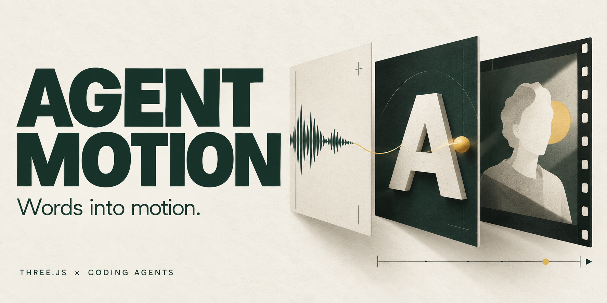
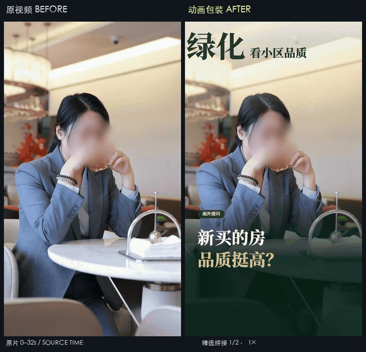
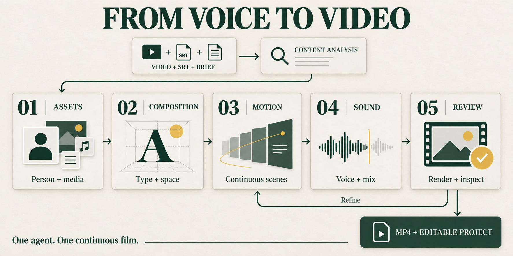
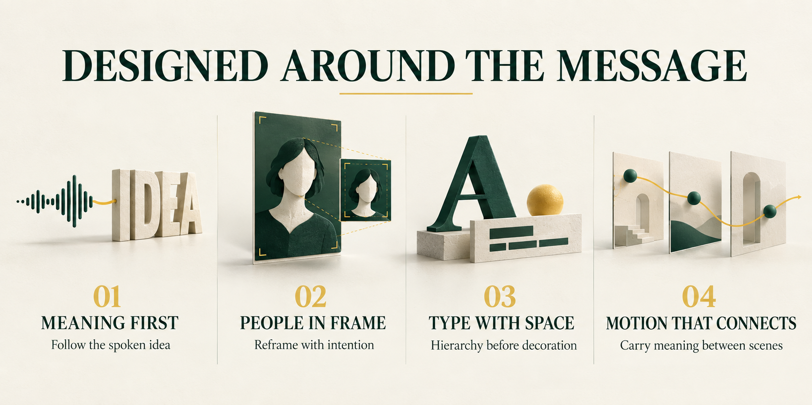

# Agent Motion

Native DeepSeek Harness plugin: install this bundle to discover the `agent-motion`, `motion-craft`, and `srt-reference-to-three` skills. See [installation and usage](docs/deepseek-harness.md).

Version 1.6.0 provides the DSH Web “动效工坊” sidebar workspace and `/agent-motion/`: upload a portrait MP4, enter narration/subtitle text, then choose a style and size. By default, the server clones the voice from the uploaded video for CosyVoice-v3.5-plus; an existing model-bound voice ID remains available as an alternative. It then generates narration and a MuseTalk talking-head video before running the original production skills. SRT imports use their text for narration and receive new timings. The page restores the chosen voice source and task settings, and displays audio/avatar previews, the finished MP4, a downloadable editable Three.js project ZIP and an HTML preview. New tasks use the latest production Skill requirements, layout and effects; existing tasks keep their rule snapshots. See [editing Skills](docs/user-manual.md#修改制作-skill).

Video voice cloning uses up to the first 20 seconds and requires at least 5 seconds of clear speech from one speaker. Trim leading silence before uploading; a silent video cannot provide a clone. Video voice mode automatically runs the production workspace bootstrap if FFmpeg or FFprobe is missing, and checks both tools before paid API calls. The first setup can take a while; preparing it in advance is recommended for deployment. Existing voice ID mode keeps the original skill installation steps. Each execution uses paid speech and avatar services, and video voice mode also calls voice cloning. Configure Beijing DashScope, MuseTalk and a private Tencent Cloud COS bucket in Harness Settings → 动效工坊; changes apply after saving and the production page updates automatically, without an environment file or restart. A default voice ID is optional. Saved secrets only show configured status; blank secret fields preserve existing values and explicit clear checkboxes remove them. Secrets stay on the server and are never written to browser storage or prompts. Environment variables remain available for CLI compatibility. COS uses the full name-APPID bucket name and Tencent Cloud SecretId / SecretKey, with an optional STS SessionToken. The default endpoint is https://cos.ap-beijing.myqcloud.com; the region is derived from it. Limit PutObject / GetObject permissions to the required private objects. Publicly reachable signed COS URLs, valid for three hours, let Alibaba voice cloning and the avatar service read source media while the bucket stays private. CosyVoice remains on Beijing DashScope. Stopping locally does not guarantee cancellation of upstream paid work, and uncertain submissions must be checked rather than resubmitted. [Configuration and validation scope](docs/deployment.md#服务端配音数字人与-cos-配置).

Adapted from [erduo1998-cell/agent-motion](https://github.com/erduo1998-cell/agent-motion). The original license and author attribution are retained.

**Turn talking-head footage into a designed film with a coding agent.** The original local workflow remains available: recording + complete SRT + brief → MP4 + editable Three.js project. The Web workflow adds narration and avatar generation before this production pipeline.

[Demos](#demos) · [Get started](#start) · [How it works](#workflow) · [Compatibility](#compatibility)

**English** · [简体中文](README.zh-CN.md) · [日本語](README.ja.md) · [Español](README.es.md) · [Français](README.fr.md)

<p align="center">
  
</p>

<a id="demos"></a>

## Demos

**Greenery, explained** · 60 seconds · Original left / result right

<p align="center">
  
</p>

<p align="center"><a href="docs/media/greening.mp4">Watch the clearer MP4</a></p>

<details>
<summary><strong>Hybrid training</strong> · Expand the 60-second comparison</summary>

<p align="center">
  
</p>

<p align="center"><a href="docs/media/hybrid-opening.mp4">Watch the clearer MP4</a></p>

</details>

<details>
<summary><strong>Teacher communication</strong> · Expand the 60-second comparison</summary>

<p align="center">
  
</p>

<p align="center"><a href="docs/media/communication.mp4">Watch the clearer MP4</a></p>

</details>

Three owner-approved films with matching source timecodes, tracked soft-edged face blur and silent previews. [Versions, excerpts and viewing scope](docs/demo-evidence.md)

<a id="start"></a>

## Get started

**1. Download and install**

You only need **Node.js 22+ and a coding agent**. Download this repository with **Code → Download ZIP**, then extract it; Git is not required. Open the extracted folder and double-click **`start.command` on macOS** or **`start.bat` on Windows**. On Linux, or from your agent's terminal, run:

```sh
node scripts/bootstrap.mjs
```

`npm run onboard` runs the same installer. It prepares the project dependencies, local Python environment, Chromium, FFmpeg / ffprobe and the person-matting model, then checks the environment and runs a short matting test. The first run needs an internet connection; let it finish. You do not need to install Python separately or tune a model. [Step-by-step guide and troubleshooting](docs/getting-started.md#english)

**2. Give your agent the brief**

Put your recording and complete SRT in `inputs/`, open the extracted folder in your coding agent, and send:

> Read AGENTS.md, follow the installation guide if needed, then read the two project-local Skills. Create a complete talking-head film using inputs/source.mp4 and inputs/source.srt. Prepare and verify a synchronized person cutout before composition; keep the original speech order and timing. Work in work/my-first-film/. Complete every production stage and inspect the actual picture and audio. Deliver the MP4 and editable project. Respond in English.

**Person matting is required for talking-head films.** The installer supplies a local CPU-capable method; a suitable existing person layer or another compatible tool can replace that method. A dedicated GPU is not required. Image generation remains optional.

**3. View the result**

Ask your agent to open the finished MP4 and editable preview. It can run `npm run serve` and open the film page it created at [work/my-first-film/](http://127.0.0.1:8793/work/my-first-film/). The server root has no preset film.

<details>
<summary>Checks your agent can run</summary>

```sh
npm run doctor -- --matting
npm test
npm run smoke
```

Doctor checks the matting environment; the rendering smoke performs a real Three.js → H.264 render. Neither replaces reviewing the person edges and the finished film. Installation and these local checks do not call paid generation services.

</details>

<a id="workflow"></a>

## How it works

Analyze the complete subtitles, then prepare assets and the person layer, compose type and space, animate continuously, mix sound, and review the output.

<p align="center">
  
</p>

One continuous author develops the opening and hardest passage before expanding the film. The agent reads each stage, preserves speech timing and inspects the actual picture and sound.

<details>
<summary>Design principles: meaning, people, typography and continuous motion</summary>

<p align="center">
  
</p>

- **Meaning first**: choose actions that explain the spoken idea; keep evidence and timing intact.
- **A person in space**: keep a synchronized person layer, visible depth and intentional framing. Outline only when replacing the original background.
- **Typography with a role**: compare fonts in real compositions; establish hierarchy, readable landings and reading time.
- **Continuous movement**: carry objects and attention between ideas. Validate a continuous sample before expanding the film.

</details>

<a id="compatibility"></a>

## Compatibility

**Agents**: Codex, Claude Code, Gemini CLI, Cursor and GitHub Copilot have entry instructions for the same local Skills. Other agents can read `AGENTS.md` directly. No Codex-specific API is required. Hosts need file, terminal, browser and audiovisual inspection capabilities.

**Platforms**: all six Windows, macOS and Ubuntu × Node 22/24 CI jobs passed automatic setup, real CPU matting and video-rendering checks on September 20, 2026. Full-film production is evidenced in Codex; the other clients have not each completed an independent full-film test. [Compatibility and test evidence](docs/compatibility.md)

## Explore further

- [Architecture](docs/architecture.md) — the two Skills, toolchain and repository structure.
- [Reference analysis library](reference-library/analysis/README.md) — 43 cases, 109 mechanism windows and five tutorial methods; text / JSON only, without reference footage, audio, frames or complete transcripts.
- [Contributing](CONTRIBUTING.md) — how to make and verify changes.

READMEs are available in five languages; canonical Skills are maintained in Chinese. Agents can work in your language. Check fonts, glyphs, line breaks and reading time for each film. The Web workflow generates Chinese narration from the submitted text; automatic translation is not included. Real paid API production is separate from local rendering and mock tests.

## License

**Noncommercial use. Commercial use requires prior written permission.**

Project-owned code, Skills, documents and analysis use **Motion Craft Community License 1.0**, a custom license based on Apache-2.0 terms with noncommercial restrictions. Fonts and dependencies retain their licenses; demo footage is excluded from the project grant.

[Full license](LICENSE) · [Commercial permission](COMMERCIAL-LICENSE.md) · [Third-party notices](THIRD_PARTY_NOTICES.md)
